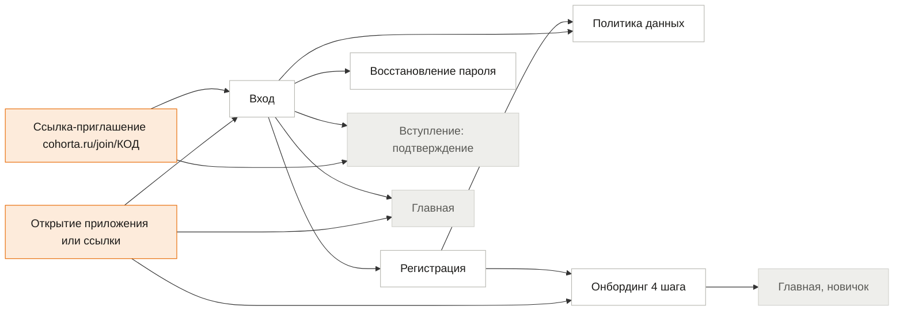
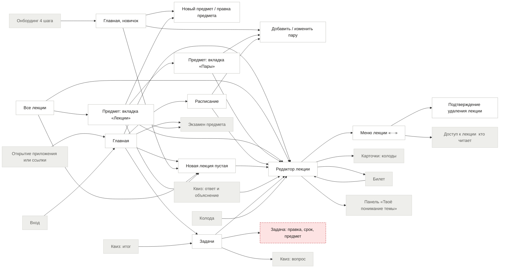
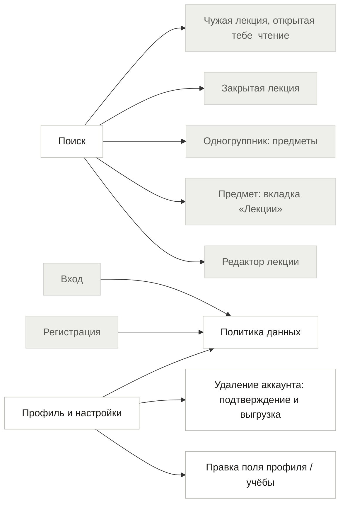
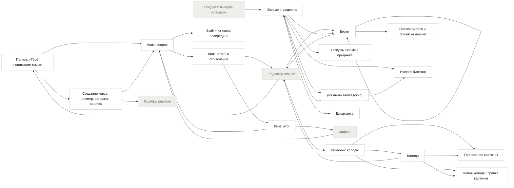
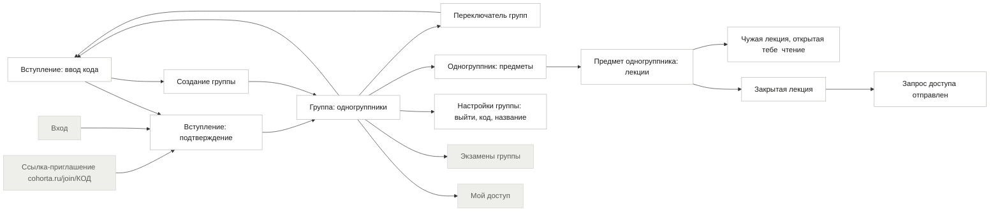
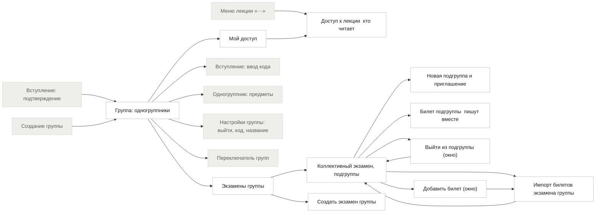

# Карта переходов cohorta (userflow)

Единственное место, где записано, из какого экрана можно попасть в какой и как. Для людей и для Claude Code.

## Как этим пользоваться (Claude Code)

1. Перед реализацией экрана найди его в таблицах ниже. Реализуй **все** входы и выходы из строки: каждая кнопка и ссылка из колонок «Откуда входят» и «Куда ведёт» должна работать.
2. Если у экрана нет входа или выхода, а нужен, или в таблице написано «не нарисован», **остановись и спроси**, не придумывай экран.
3. Колонку «Маршрут в коде» заполняй сам по реальному роутеру (пути вида `/s/:semesterSlug/...`). Расхождение между картой и роутером запиши в `PROGRESS.md`.
4. Новый экран или новый переход в коде: сначала строка в этой карте (и в `userflow.json`), потом код.
5. Название и поведение экранов служебных состояний (нет связи, ошибка, закрыта, сессия истекла) берутся из `States-system`.

Всего экранов и состояний: **71**; список «не нарисовано» см. заметки в строках.

## Дыры, найденные при составлении карты

> Устарело на 21.10. Большинство дыр закрыто макетами и решениями (`CHANGES-2026-10-19.md`, `instructions/userflow-decisions-2026-10-19.md`): регистрация, восстановление пароля, онбординг из 4 шагов, удаление аккаунта, служебные состояния, формы, меню лекции, квиз, билет подгруппы и настройки группы нарисованы. Не нарисованы: правка задачи, экран настроек уведомлений (в MVP нет), телефонные макеты онбординга, политики, 404 и окон удаления.

### Блокирует запуск

| # | Что не так | Экраны | Что нужно |
|---|---|---|---|
| 1.1 | **Регистрация и восстановление пароля не нарисованы.** Со входа есть ссылки «Создать аккаунт» и «Забыли пароль?», но за ними пусто. Нужно решить, подтверждается ли почта, и нарисовать: регистрация, письмо отправлено, новый пароль, пароль изменён. | `register, reset` | Решение Маргариты + макеты |
| 1.2 | **Чужая лекция, открытая тебе: экрана нет.** Это главный итог всей группы: одногруппник открыл лекцию, ты нажимаешь «Открыта тебе» и... куда? Нужно решить: только чтение или можно проходить квиз, делать карточки, копировать себе? Как выглядит шапка («Лекция Игоря Власова, только чтение»). | `g_read` | Решение Маргариты + макет |
| 1.3 | **Страница предмета, вкладка «Лекции».** Клик по предмету в меню слева и по ряду предметов на телефоне ведёт сюда. Есть вкладки «Пары» и «Экзамен», самой главной вкладки «Лекции» нет. Без неё путь «меню → предмет → лекция» не работает. | `subject` | Макет (десктоп и телефон) |
| 1.4 | **Создание квиза: размер, ожидание, ошибка ИИ.** После «Создать квиз» нет ни выбора размера, ни экрана ожидания, ни ошибки, если ИИ не ответил (превышен лимит, пустой конспект, нет связи). Это самое хрупкое место продукта. | `quiz_create` | Макет состояний |
| 1.5 | **Кто видит код приглашения: макет спорит с правилом безопасности.** В инструкции (шаг A0.5) код видит только владелец группы. В макете «Группа МК-31» код и «Сбросить код» показаны обычному участнику (Анастасия не создавала группу). Нужно выбрать: код видят все участники (проще, но любой может сбросить) или только владелец. Заодно решить, есть ли у группы владелец и что с ним, если он выйдет. | `g_home, g_settings` | Решение Маргариты |
| 1.6 | **Ссылка-приглашение у не вошедшего.** Человек открывает cohorta.ru/join/КОД, у него нет аккаунта: код должен пережить регистрацию, онбординг и вход, и в конце показать подтверждение вступления, а не главную. Это главный способ привлечь первых людей. | `join_link, login, onb` | Решение + реализация |
| 1.7 | ~~Онбординг~~ — решено: 4 шага (имя и фото; город и вуз; уровень и курс; периоды), шага «Группа» нет. | `onb` | Закрыто |

### Нужно до запуска

| # | Что не так | Экраны | Что нужно |
|---|---|---|---|
| 2.1 | **Формы создания: предмет, пара, колода и карточка, экзамен, подгруппа, экзамен группы.** Везде есть кнопки «Добавить…», но формы не нарисованы. Часть можно собрать из готовых компонентов (окно с полями), но состав полей нужно определить. Подгруппа: как выбираются люди, что видит приглашённый, как не нарушить «один человек: одна подгруппа». | `subject_new, pair_edit, deck_edit, exam_new, g_exam_new, g_sub_new` | Макеты (можно одним листом «Формы») |
| 2.2 | **Новая лекция без предмета.** «Новая лекция» на главной: в какой предмет она попадает? Предложение: окно выбора предмета, последний использованный выбран заранее. Сейчас не определено. | `home, lecture_new` | Решение Маргариты |
| 2.3 | **Меню лекции «···» и удаление.** Туда ведёт «Доступ», но меню не нарисовано: переименовать, перенести в другой предмет, доступ, удалить. Удаление необратимо: нужно подтверждение, лучше с «Корзиной» на 30 дней. | `lecture_menu, lecture_delete` | Макет + решение про корзину |
| 2.4 | **Уведомления: как узнать про запрос и про открытый доступ.** Есть только счётчик у «Мой доступ». Если тебе открыли лекцию, об этом никто не сообщает. Предложение для MVP: счётчик на значке «Группа» и пометка «Новое» у открытой лекции; письма и пуши после запуска. | `g_myaccess` | Решение Маргариты |
| 2.5 | **Настройки группы: выйти, переименовать, сбросить код.** Выйти из группы нигде нельзя. Что происходит с чужими доступами к твоим лекциям и с твоим местом в подгруппе после выхода, не определено. | `g_settings` | Решение + макет |
| 2.6 | **Удаление аккаунта: подтверждение и выгрузка.** В настройках обещано «попросим подтвердить и предложим выгрузить данные», экрана нет. Нужен для заявленной политики данных. | `account_delete` | Макет |
| 2.7 | **Служебные: сессия истекла, лекции или группы нет, неверная ссылка.** Не определено, что видит человек, если лекцию удалили, его исключили или сессия закончилась на середине конспекта. Незаписанный текст не должен пропасть. | `expired, gone` | Макет + правило сохранения |
| 2.8 | **Билет подгруппы (совместная правка).** В тексте экрана «Билеты внутри подгруппы пишут вместе», но самого экрана билета подгруппы нет: кто сейчас пишет, что при одновременной правке, куда сохраняется ответ. | `g_ticket` | Макет + решение |
| 2.9 | **Выход из квиза посередине.** Закрыл вкладку или нажал назад на вопросе 5 из 8: прогресс сохраняется или нет? Предложение: сохраняется, при возвращении «Продолжить квиз». | `quiz_exit` | Решение |
| 2.10 | **Выбор лекции для билета.** «Привязать лекцию» ведёт в выбор, которого нет в макетах (поиск по лекциям предмета, несколько штук). | `ticket_edit` | Макет |

### Можно после запуска

| # | Что не так | Экраны | Что нужно |
|---|---|---|---|
| 3.1 | **Вкладка «Расписание повторов» у карточек.** Заголовок вкладки есть, содержимого нет. Можно оставить на после запуска, убрав вкладку. | `cards` | Решение |
| 3.2 | **Правка профиля и учёбы.** Рядом с каждым полем «Изменить». Окна простые, можно собрать из компонентов без отдельных макетов. | `settings_edit` | Реализация по компонентам |

### Уже исправлено при составлении карты

- В трёх текстах макетов было «Cohorta» с заглавной (онбординг, пустое состояние задач). Исправлено на «cohorta».
- Заголовок экрана «Курс одногруппника» заменён на «Предмет одногруппника» (по правилу «курс» только про год обучения).

## Схемы по разделам

Сплошная рамка: экран нарисован. Красная пунктирная: экрана нет. Серая: экран из другого раздела. Оранжевая: вход в приложение.

### Старт

Вход, регистрация, восстановление пароля, онбординг, ссылка-приглашение.

### Соло: учёба

Главная, лекции, предметы, расписание, задачи, редактор.

### Поиск и настройки

Поиск открывается с любого экрана, настройки через аватар.

### Соло: квиз, карточки, экзамен

Понимание темы, квиз, карточки, экзамен, билеты.

### Группа: вступление и люди

Вступить, создать, переключить группу, одногруппники и их лекции.

### Группа: доступ и экзамены

Мой доступ, доступ к лекции, экзамены группы и подгруппы.

## Экран за экраном

### Старт

| Экран | Макет | Откуда входят | Куда ведёт | Маршрут в коде | Заметки |
|---|---|---|---|---|---|
| **Открытие приложения или ссылки** (`open`) | нет (не экран) | вход в приложение | Вход: не вошёл Главная: вошёл, онбординг пройден Онбординг (4 шага): вошёл, онбординг не пройден | / (HomeRedirect, ProtectedRoute); не вошёл → /login; онбординг не пройден → /onboarding |  |
| **Вход** (`login`) | Screen-login | Открытие приложения или ссылки: не вошёл Восстановление пароля: после нового пароля Политика данных: «Вход» / назад Ссылка-приглашение cohorta.ru/join/КОД: не вошёл (код сохраняется) Профиль и настройки: выйти Удаление аккаунта: подтверждение и выгрузка: после удаления Сессия истекла: «Войти снова» | Главная: «Войти» Регистрация: «Создать аккаунт» Восстановление пароля: «Забыли пароль?» Политика данных: ссылка «политикой данных» Вступление: подтверждение: вошёл по ссылке: вернуться к подтверждению | /login (pages/auth/LoginPageNew.tsx) | «Забыли пароль?» ведёт на «Напиши в поддержку» (флаг VITE_AUTH_EMAIL выключен, пока нет почты) |
| **Регистрация** (`register`) | Screen-register; Screen-m-register | Вход: «Создать аккаунт» | Онбординг (4 шага): после регистрации Политика данных: ссылка политики | /register (LoginPageNew, mode=register) | Почта, пароль, повтор пароля. Шаг «подтверди почту» подготовлен и выключен |
| **Восстановление пароля** (`reset`) | Screen-auth-reset | Вход: «Забыли пароль?» | Вход: после нового пароля | /reset, /reset/confirm/:token (pages/auth/ResetPages.tsx) | Экраны за флагом VITE_AUTH_EMAIL (выключен). Пока «Напиши в поддержку»; включить, когда появится почта |
| **Политика данных** (`policy`) | Screen-policy | Вход: ссылка «политикой данных» Регистрация: ссылка политики Профиль и настройки: «Читать» | Вход: «Вход» / назад | /privacy (pages/auth/PolicyPageNew.tsx) |  |
| **Онбординг (4 шага)** (`onb`) | Screen-onboarding-1; Screen-onboarding-2; Screen-onboarding-3; Screen-onboarding-4 | Открытие приложения или ссылки: вошёл, онбординг не пройден Регистрация: после регистрации | Главная, новичок: после последнего шага | /onboarding (features/onboarding/OnboardingNew.tsx) | Шаги: имя и фото; город и вуз; уровень и курс; периоды. Шага «Группа» нет; после онбординга Главная (Соло) |
| **Ссылка-приглашение cohorta.ru/join/КОД** (`join_link`) | нет (не экран) | вход в приложение | Вход: не вошёл (код сохраняется) Вступление: подтверждение: вошёл | /join/:code (JoinRoute); код хранится в localStorage | Не вошедшего ведёт на регистрацию и потом возвращает к подтверждению; автовступления нет |

### Соло: учёба

| Экран | Макет | Откуда входят | Куда ведёт | Маршрут в коде | Заметки |
|---|---|---|---|---|---|
| **Главная** (`home`) | Screen-dashboard; Screen-dashboard-mobile | Открытие приложения или ссылки: вошёл, онбординг пройден Вход: «Войти» Онбординг (4 шага): после шага 4 Настройки группы: выйти, код, название: «Выйти из группы» Нет связи: сеть вернулась Ошибка загрузки: «Повторить» Лекции или группы больше нет / нет прав: «На главную» | Поиск: строка поиска в шапке Профиль и настройки: аватар внизу меню Редактор лекции: «Продолжить», «Открыть лекцию», «Открыть конспект» Новая лекция (пустая): «Новая лекция», «Начать конспект» (без пары открывает чистую) Редактор лекции: «Начать конспект» на паре (создаёт лекцию на дату пары) Задачи: «Все задачи» Расписание: «Расписание» Квиз: вопрос: задача «Пройти квиз…», «Повторить» в блоке «Что повторить» Экзамен предмета: блок «Экзамен» (когда есть) | / → /s/:semesterSlug (pages/DashboardNew.tsx) |  |
| **Главная, новичок** (`home_new`) | States-empty | Онбординг (4 шага): после последнего шага | Новый предмет / правка предмета: «Добавить» предмет Добавить / изменить пару: «Добавить» пару Новая лекция (пустая): «Начать» | /s/:semesterSlug (та же страница, состояние «новичок») | Блок «С чего начать» |
| **Все лекции** (`lectures`) | Screen-lectures; Screen-lectures-period; Screen-m-lectures-all; Screen-m-lectures-subjects; Screen-m-lectures-period | Подтверждение удаления лекции: подтвердил | Редактор лекции: строка лекции Новая лекция (пустая): «Новая лекция» Предмет: вкладка «Лекции»: ряд предметов (телефон) / предмет в меню | /s/:semesterSlug/lectures (pages/LecturesAllPage.tsx) |  |
| **Предмет: вкладка «Лекции»** (`subject`) | Screen-subject-lectures; Screen-m-subject-lectures | Все лекции: ряд предметов (телефон) / предмет в меню Новый предмет / правка предмета: «Сохранить» Предмет: вкладка «Пары»: вкладка «Лекции» Редактор лекции: ссылка назад к предмету Поиск: предмет | Редактор лекции: строка лекции Предмет: вкладка «Пары»: вкладка «Пары» Экзамен предмета: вкладка «Экзамен» Новый предмет / правка предмета: правка предмета Новая лекция (пустая): «Новая лекция» | /s/:semesterSlug/:courseSlug (pages/SubjectLecturesPage.tsx) | Нарисована (Screen-subject-lectures, Screen-m-subject-lectures): вкладки «Лекции N / Пары N / Экзамен». |
| **Новый предмет / правка предмета** (`subject_new`) | Screen-forms-create; Screen-m-form-subject | Главная, новичок: «Добавить» предмет Предмет: вкладка «Лекции»: правка предмета | Предмет: вкладка «Лекции»: «Сохранить» | окно useForms().openSubjectForm(), без своего маршрута | Нарисовано: одно поле «Название», обложка создаётся сама, период подставляется текущий. |
| **Предмет: вкладка «Пары»** (`pairs`) | Screen-subject-pairs; Screen-m-subject-pairs | Предмет: вкладка «Лекции»: вкладка «Пары» Добавить / изменить пару: «Сохранить» | Добавить / изменить пару: «Добавить пару», строка пары Редактор лекции: «Конспект есть» Предмет: вкладка «Лекции»: вкладка «Лекции» | /s/:semesterSlug/:courseSlug/pairs (pages/SubjectPairsPage.tsx) |  |
| **Добавить / изменить пару** (`pair_edit`) | Screen-forms-create; Screen-m-form-pair | Главная, новичок: «Добавить» пару Предмет: вкладка «Пары»: «Добавить пару», строка пары Расписание: «Добавить пару» | Предмет: вкладка «Пары»: «Сохранить» | окно (components/schedule/SlotFormNew.tsx), `/schedule?add=1` открывает его сразу | Нарисовано: предмет, день, пара, недели, тип, аудитория, преподаватель; занятая клетка показывает пару, которая мешает. |
| **Расписание** (`schedule`) | Screen-schedule; Screen-m-schedule | Главная: «Расписание» | Редактор лекции: пара с конспектом Редактор лекции: «Начать конспект» Добавить / изменить пару: «Добавить пару» | /schedule (pages/SchedulePageNew.tsx) |  |
| **Новая лекция (пустая)** (`lecture_new`) | States-empty | Главная: «Новая лекция», «Начать конспект» (без пары открывает чистую) Главная, новичок: «Начать» Все лекции: «Новая лекция» Предмет: вкладка «Лекции»: «Новая лекция» | Редактор лекции: начал писать | /note/new → создаёт «Лекция N» в «Черновиках» и открывает /note/:lectureSlug/edit | Новая лекция без названия. Куда попадает, если предмет не выбран, не решено |
| **Редактор лекции** (`editor`) | Screen-editor; Screen-m-editor | Главная: «Продолжить», «Открыть лекцию», «Открыть конспект» Главная: «Начать конспект» на паре (создаёт лекцию на дату пары) Все лекции: строка лекции Предмет: вкладка «Лекции»: строка лекции Предмет: вкладка «Пары»: «Конспект есть» Расписание: пара с конспектом Расписание: «Начать конспект» Новая лекция (пустая): начал писать Квиз: ответ и объяснение: «Показать в лекции, абзац…» Выйти из квиза посередине: выйти Квиз: итог: «К лекции», «Закрыть» Задачи: задача со ссылкой на лекцию Поиск: своя лекция Колода: «Лекция N» у карточки Билет: «Связанные лекции» | Меню лекции «···»: «···» Предмет: вкладка «Лекции»: ссылка назад к предмету Панель «Твоё понимание темы»: правая панель (на телефоне: кнопка «Понимание») Билет: плашка «Нужна для N билетов» Карточки: колоды: «+ Карточка» из меню «/» | /s/:semesterSlug/:courseSlug/:lectureSlug (и /edit); без предмета /note/:lectureSlug | Содержание лекции: Screen-editor-toc и Screen-m-editor-toc. Меню «/»: Screen-editor-slash |
| **Меню лекции «···»** (`lecture_menu`) | Screen-lecture-menu; Screen-m-lecture-menu; Screen-m-lecture-move | Редактор лекции: «···» | Подтверждение удаления лекции: «Удалить» Доступ к лекции (кто читает): «Доступ» | меню «···» в шапке лекции и в строках списков (components/lectures/useLectureActions.tsx) | Нарисовано: переименовать, перенести в предмет, дублировать, доступ, скачать .md, удалить. «Доступ в группе» видно только состоящему в группе. |
| **Подтверждение удаления лекции** (`lecture_delete`) | Screen-m-lecture-delete | Меню лекции «···»: «Удалить» | Все лекции: подтвердил | окно подтверждения; удаление кладёт в корзину (/trash) на 30 дней | Нарисовано (телефон; на десктопе то же окно): в корзину на 30 дней, доступ группы пропадает сразу. |
| **Задачи** (`tasks`) | Screen-tasks; Screen-m-tasks | Главная: «Все задачи» Квиз: итог: автозадача «Повторить через день» Задача: правка, срок, предмет: «Сохранить» | Задача: правка, срок, предмет: строка задачи Редактор лекции: задача со ссылкой на лекцию Квиз: вопрос: задача «Квиз…» | /tasks (pages/TasksPageNew.tsx) |  |
| **Задача: правка, срок, предмет** (`task_edit`) | не нарисован | Задачи: строка задачи | Задачи: «Сохранить» | нет отдельного экрана: правка в строке | Не нарисовано (быстрое добавление строкой есть) |
| **Поиск** (`search`) | Screen-search; Screen-m-search | Главная: строка поиска в шапке Группа: одногруппники: строка поиска в шапке | Редактор лекции: своя лекция Предмет: вкладка «Лекции»: предмет Одногруппник: предметы: одногруппник Закрытая лекция: чужая лекция (видно только название) Чужая лекция, открытая тебе (чтение): чужая лекция, открытая тебе | оверлей (components/SearchOverlay.tsx), без маршрута; ⌘K / Ctrl+K | Строка в шапке на каждом экране |
| **Профиль и настройки** (`settings`) | Screen-settings | Главная: аватар внизу меню Группа: одногруппники: «Профиль» Правка поля профиля / учёбы: «Сохранить» | Правка поля профиля / учёбы: «Изменить», «Сменить фото» Политика данных: «Читать» Удаление аккаунта: подтверждение и выгрузка: «Удалить аккаунт» Вход: выйти | /settings (pages/SettingsPage.tsx); на компьютере /profile → /settings | Левый список — оглавление. «Начало недели» не сделано: в базе нет поля |
| **Правка поля профиля / учёбы** (`settings_edit`) | Screen-settings-inline | Профиль и настройки: «Изменить», «Сменить фото» | Профиль и настройки: «Сохранить» | на месте, один компонент ui/EditableRow; на телефоне шторка | Строка превращается в поле, «Сохранить» / «Отмена» |
| **Удаление аккаунта: подтверждение и выгрузка** (`account_delete`) | Screen-account-delete | Профиль и настройки: «Удалить аккаунт» | Вход: после удаления | окно из /settings (components/settings/*): 1 предупреждение и ZIP, 2 подтверждение; 3 экран «Аккаунт будет удалён …» при входе (pages/PendingDeletionPage.tsx) | Через 14 дней серверная задача стирает данные; вход до этого показывает экран отмены |
| **Занятия (телефон)** (`more`) | Screen-m-more | Нижняя панель: «Занятия» | Задачи: «Задачи» Карточки: колоды: «Карточки» | /more (pages/MorePage.tsx) | Нижняя панель, 4-е место: Задачи, Карточки |
| **Профиль (телефон)** (`profile`) | Screen-m-profile; Screen-m-profile-group | Нижняя панель: кружок «Профиль» | Профиль и настройки: «Профиль и данные» Периоды учёбы: «Периоды учёбы» Корзина: «Корзина» Политика данных: «Политика данных» Вход: «Выйти» | /profile (pages/ProfilePage.tsx); на компьютере → /settings | Соло/Группа, профиль и данные, периоды, корзина, политика, выйти. Строка «Уведомления» скрыта: экрана настроек уведомлений в MVP нет. «Мой доступ» и «Настройки группы» — волна C |
| **Периоды учёбы** (`settings_periods`) | Screen-settings-periods; Screen-m-settings-periods | Профиль и настройки: «Периоды учёбы» Профиль (телефон): «Периоды учёбы» Онбординг (4 шага): шаг 4 (те же правила) | Профиль и настройки: «Готово» | /settings/periods (pages/SettingsPeriodsPage.tsx) | Форма обучения, тип, количество, даты, «Сделать текущим». Автопереключения по датам нет |
| **Корзина** (`trash`) | Screen-trash; Screen-m-trash | Профиль и настройки: «Корзина» Профиль (телефон): «Корзина» Подтверждение удаления лекции: удалил | Редактор лекции: «Восстановить» лекцию Предмет: вкладка «Лекции»: «Восстановить» предмет | /trash (pages/TrashPage.tsx); сервер /api/trash | Лекции и предметы, хранение 30 дней, «Восстановить», «Удалить навсегда», «Очистить корзину» |
| **Черновики** (`drafts`) | Screen-drafts; Screen-m-drafts; Screen-m-drafts-assign | Все лекции: строка «Черновики» | Редактор лекции: строка лекции Все лекции: назначил предмет | /s/:semesterSlug/drafts (pages/DraftsPage.tsx) | Предмет по умолчанию для лекций без предмета |

### Соло: повторение и экзамен

| Экран | Макет | Откуда входят | Куда ведёт | Маршрут в коде | Заметки |
|---|---|---|---|---|---|
| **Панель «Твоё понимание темы»** (`understanding`) | Screen-understanding; Screen-m-understanding | Редактор лекции: правая панель (на телефоне: кнопка «Понимание») | Создание квиза (размер, загрузка, ошибка): «Создать квиз», «Собрать другой» Квиз: вопрос: «Пройти квиз», «Проверить себя» | /s/:semesterSlug/:courseSlug/:lectureSlug (правая панель; телефон — шторка по кнопке «Понимание») | Четыре состояния: нет квиза, квиз создан, квиз начат, квиз пройден. Создать квиз может только владелец лекции; гостю при отсутствии квиза текст без кнопки |
| **Создание квиза (размер, загрузка, ошибка)** (`quiz_create`) | Screen-quiz-states; Screen-m-quiz-1; Screen-m-quiz-2; Screen-m-quiz-3 | Панель «Твоё понимание темы»: «Создать квиз», «Собрать другой» | Квиз: вопрос: квиз готов Ошибка загрузки: ИИ не ответил | окно поверх лекции (components/quiz/QuizCreateDialog.tsx); POST /api/quiz/generate | Нарисовано: размер, ожидание, ошибка, мало текста, лимит исчерпан. Лимит считается по созданию квиза (5 в день), текст не короче 300 знаков |
| **Квиз: вопрос** (`quiz_q`) | Screen-quiz-question; Screen-m-quiz | Главная: задача «Пройти квиз…», «Повторить» в блоке «Что повторить» Панель «Твоё понимание темы»: «Пройти квиз», «Проверить себя» Создание квиза (размер, загрузка, ошибка): квиз готов Квиз: ответ и объяснение: «Дальше» Квиз: итог: «Повторить слабые темы» Задачи: задача «Квиз…» | Квиз: ответ и объяснение: «Ответить», «Не помню» Выйти из квиза посередине: закрыть | /quiz/:lectureId (pages/QuizPage.tsx) |  |
| **Квиз: ответ и объяснение** (`quiz_a`) | Screen-quiz-answered | Квиз: вопрос: «Ответить», «Не помню» | Квиз: вопрос: «Дальше» Редактор лекции: «Показать в лекции, абзац…» Квиз: итог: последний вопрос | /quiz/:lectureId (тот же экран) |  |
| **Квиз: итог** (`quiz_sum`) | Screen-quiz-summary | Квиз: ответ и объяснение: последний вопрос | Квиз: вопрос: «Повторить слабые темы» Редактор лекции: «К лекции», «Закрыть» Задачи: автозадача «Повторить через день» | /quiz/:lectureId (тот же экран, после последнего вопроса) |  |
| **Выйти из квиза посередине** (`quiz_exit`) | Screen-quiz-states (блок «квиз начат») | Квиз: вопрос: закрыть | Редактор лекции: выйти | /quiz/:lectureId, «Выйти» ведёт на лекцию | Прогресс сохраняется, «Продолжить» идёт с первого неотвеченного вопроса |
| **Карточки: колоды** (`cards`) | Screen-cards; Screen-m-cards | Редактор лекции: «+ Карточка» из меню «/» Повторение карточек: «Закончить» | Колода: колода Повторение карточек: «Повторить N карточек» Новая колода / правка карточки: «Новая колода» | /decks (pages/CardsPageNew.tsx) | Вкладка «Расписание повторов» не нарисована |
| **Колода** (`deck`) | Screen-deck; Screen-m-deck | Карточки: колоды: колода Новая колода / правка карточки: «Сохранить» | Повторение карточек: «Повторить N карточек» Новая колода / правка карточки: «Добавить карточку» Редактор лекции: «Лекция N» у карточки | /decks/:slug (pages/DeckPageNew.tsx) |  |
| **Новая колода / правка карточки** (`deck_edit`) | Screen-forms-create; Screen-m-form-card | Карточки: колоды: «Новая колода» Колода: «Добавить карточку» | Колода: «Сохранить» | окна «Новая колода» и «Новая карточка» (components/forms/); правка карточки и /decks/new, /decks/:slug/edit — прежний DeckEditorPage | Нарисованы окна «Новая колода» и «Новая карточка». Правка карточки не нарисована. |
| **Повторение карточек** (`cards_review`) | Screen-cards-review | Карточки: колоды: «Повторить N карточек» Колода: «Повторить N карточек» | Карточки: колоды: «Закончить» | /decks/:slug/review, /cards/review (pages/CardReviewPageNew.tsx) |  |
| **Экзамен предмета** (`exam`) | Screen-exam; Screen-m-exam | Главная: блок «Экзамен» (когда есть) Предмет: вкладка «Лекции»: вкладка «Экзамен» Создать экзамен предмета: «Создать» Импорт билетов: «Добавить N билетов» Шпаргалка: назад Добавить билет (окно): «Добавить» | Билет: строка билета, «Открыть билет», «Продолжить» Импорт билетов: «Импорт» Шпаргалка: вкладка «Шпаргалка» Создать экзамен предмета: нет экзамена у предмета Добавить билет (окно): «Добавить билет» | /s/:semesterSlug/:courseSlug/exam (pages/ExamHubPageNew.tsx) |  |
| **Создать экзамен предмета** (`exam_new`) | Screen-forms-create; Screen-m-form-exam | Экзамен предмета: нет экзамена у предмета | Экзамен предмета: «Создать» | окно (components/forms/ExamFormDialog.tsx) | Нарисовано: предмет, дата, пустое состояние «Экзамена пока нет». Если в группе есть экзамен по предмету с тем же названием, под полями подсказка, и экзамен присоединяется к нему. |
| **Билет** (`ticket`) | Screen-ticket | Редактор лекции: плашка «Нужна для N билетов» Экзамен предмета: строка билета, «Открыть билет», «Продолжить» Билет: «Следующий билет» Правка билета и привязка лекций: «Сохранить» | Правка билета и привязка лекций: «Изменить», «Привязать лекцию» Редактор лекции: «Связанные лекции» Билет: «Следующий билет» | /s/:semesterSlug/:courseSlug/exam/:number (pages/TicketPageNew.tsx) |  |
| **Правка билета и привязка лекций** (`ticket_edit`) | Screen-ticket; Screen-ticket-lecture-picker; Screen-m-lecture-picker | Билет: «Изменить», «Привязать лекцию» | Билет: «Сохранить» | /s/:semesterSlug/:courseSlug/exam/:number/edit; выбор лекций — окно LecturePickerDialog | Правка на месте (кнопка «Изменить»); отдельного макета правки нет. Окно «Привязать лекции к билету» нарисовано: вкладки «Мои» и «Открытые мне». |
| **Импорт билетов** (`ticket_import`) | Screen-ticket-import; Screen-m-ticket-import | Экзамен предмета: «Импорт» Добавить билет (окно): «Вставить список билетов сразу» (в соло-экзамене) | Экзамен предмета: «Добавить N билетов» | /s/:semesterSlug/:courseSlug/exam/import (pages/ExamImportPageNew.tsx) | Один билет на строку, цифры и маркеры в начале убираются, новые билеты получают следующие номера после существующих, пометка «Новый»; «Добавить N билетов» одна на экране и на виду при прокрутке. Тот же экран у экзамена группы (g_exam_import). |
| **Добавить билет (окно)** (`ticket_add`) | Screen-forms-create (раздел «Билеты экзамена»); Screen-m-ticket-add | Экзамен предмета: «Добавить билет» Коллективный экзамен, подгруппы: «Добавить билет» | Экзамен предмета: «Добавить» Импорт билетов: «Вставить список билетов сразу» (в соло-экзамене) Импорт билетов экзамена группы: «Вставить список билетов сразу» (в экзамене группы) Коллективный экзамен, подгруппы: «Добавить» | окно (components/exam/AddTicketModal.tsx) | Название и необязательный ответ; одно окно у соло-экзамена и у экзамена группы, меняется только место сохранения. «Вставить список билетов сразу» отдельной строкой слева над кнопками (на телефоне под кнопкой). |
| **Шпаргалка** (`cheatsheet`) | Screen-cheatsheet | Экзамен предмета: вкладка «Шпаргалка» | Экзамен предмета: назад | /s/:semesterSlug/:courseSlug/exam/cheatsheet (pages/CheatsheetPageNew.tsx) |  |

### Группа

| Экран | Макет | Откуда входят | Куда ведёт | Маршрут в коде | Заметки |
|---|---|---|---|---|---|
| **Вступление: ввод кода** (`g_join`) | Screen-group-join | Группа: одногруппники: «Вступить в ещё одну» / режим «Группа» без группы Вступление: подтверждение: «Это не та группа» Переключатель групп: «Вступить в ещё одну» | Вступление: подтверждение: введён код Создание группы: «Создать свою группу» | /s/:semesterSlug/group/join (GroupJoinRoute, pages/group/GroupJoinPage.tsx); человеку без группы то же показывает любой адрес группы (GroupGate) |  |
| **Вступление: подтверждение** (`g_join_ok`) | Screen-group-join-confirm | Онбординг (4 шага): пришёл по ссылке-приглашению Ссылка-приглашение cohorta.ru/join/КОД: вошёл Вход: вошёл по ссылке: вернуться к подтверждению Вступление: ввод кода: введён код | Группа: одногруппники: «Вступить в МК-31» Вступление: ввод кода: «Это не та группа» | /join (pages/auth/JoinGroupPage.tsx); без сайдбара, автовступления нет |  |
| **Создание группы** (`g_create`) | Screen-group-create | Вступление: ввод кода: «Создать свою группу» | Группа: одногруппники: «Создать группу» | /s/:semesterSlug/group/new (pages/group/GroupCreatePage.tsx) | Код показывается сразу: сервер выдаёт случайный свободный код (8 знаков, на экране «7X4P-K9QM», без 0/O и 1/I/L), «Скопировать» копирует, на секунду «Скопировано». При «Создать группу» он становится кодом группы; если его успели занять, сервер подбирает другой и владелец видит его в «Пригласить». У новой группы ссылка закрыта, владелец открывает её в «Пригласить» или в настройках. |
| **Группа: одногруппники** (`g_home`) | Screen-group-home; Screen-m-group-people | Вступление: подтверждение: «Вступить в МК-31» Создание группы: «Создать группу» Переключатель групп: выбрать группу Настройки группы: выйти, код, название: крошка «МК-31» (десктоп), «‹ Люди» (телефон, если пришли шестерёнкой), «Сохранить» | Поиск: строка поиска в шапке Профиль и настройки: «Профиль» Вступление: ввод кода: «Вступить в ещё одну» / режим «Группа» без группы Переключатель групп: карточка группы в меню Одногруппник: предметы: «Открыть» у одногруппника Настройки группы: выйти, код, название: шестерёнка в шапке (десктоп левее «Пригласить», телефон левее «+» и лупы) Мой доступ: «Мой доступ» Экзамены группы: «Экзамены группы» | /s/:semesterSlug/group (GroupHomeRoute, pages/group/GroupHomePage.tsx) | Шестерёнка «Настройки группы» у всех участников; «Пригласить» только у владельца, участнику подсказка «Чтобы позвать человека, попроси владельца». Число лекций и предметов видно только у открывших предпросмотр. Уведомления: точка у «Группа» и сообщение на 6 секунд (Screen-notifications, Screen-m-notifications), списка нет. Окна приветствия после вступления нет (в бэклоге): человек попадает на этот экран. |
| **Переключатель групп** (`g_switch`) | Screen-group-switcher; Screen-m-group-switcher | Группа: одногруппники: карточка группы в меню | Группа: одногруппники: выбрать группу Вступление: ввод кода: «Вступить в ещё одну» | без своего маршрута: поповер в сайдбаре (components/group/GroupSidebarBlock.tsx), на телефоне шторка на /s/:semesterSlug/group |  |
| **Одногруппник: предметы** (`g_member`) | Screen-group-member; Screen-m-group-people | Поиск: одногруппник Группа: одногруппники: «Открыть» у одногруппника | Предмет одногруппника: лекции: предмет одногруппника | /s/:semesterSlug/group/people/:userId (GroupMemberRoute, pages/group/GroupMemberPages.tsx) | Предметы списком, как свои; строка лекции «Лекция N · дата» из предпросмотра. |
| **Предмет одногруппника: лекции** (`g_member_subj`) | Screen-group-thumbnails | Одногруппник: предметы: предмет одногруппника Запрос доступа отправлен: назад Чужая лекция, открытая тебе (чтение): назад | Чужая лекция, открытая тебе (чтение): «Открыта тебе» Закрытая лекция: строка закрытой лекции | /s/:semesterSlug/group/people/:userId/:courseKey (GroupMemberSubjectRoute) | Файл назван «thumbnails», но это список. У закрытых «Запросить доступ», у открытых тебе «Открыта тебе» и «Новое». |
| **Чужая лекция, открытая тебе (чтение)** (`g_read`) | Screen-shared-lecture; Screen-shared-add; Screen-shared-dialogs | Поиск: чужая лекция, открытая тебе Предмет одногруппника: лекции: «Открыта тебе» | Предмет одногруппника: лекции: назад | /s/:semesterSlug/group/lecture/:lectureId (GroupLectureRoute, pages/group/GroupLecturePage.tsx) | Только чтение (чужой HTML чистится). «Добавить в мои конспекты» только при разрешённом копировании; состояние «Нужно согласие владельца» не делаем, запрос разрешения в бэклоге. |
| **Закрытая лекция** (`g_closed`) | Screen-group-thumbnails; Screen-shared-dialogs | Поиск: чужая лекция (видно только название) Предмет одногруппника: лекции: строка закрытой лекции | Запрос доступа отправлен: «Запросить доступ» | без своего маршрута: строка закрытой лекции на /s/:semesterSlug/group/people/:userId/:courseKey | Видно только название; кнопка «Запросить доступ». |
| **Запрос доступа отправлен** (`g_sent`) | Screen-group-thumbnails; Screen-shared-dialogs | Закрытая лекция: «Запросить доступ» | Предмет одногруппника: лекции: назад | без своего маршрута: плашка «Запрос отправлен» в той же строке |  |
| **Мой доступ** (`g_myaccess`) | Screen-group-access-my; Screen-m-group-access | Группа: одногруппники: «Мой доступ» Доступ к лекции (кто читает): «Готово» | Доступ к лекции (кто читает): «Открыть» у запроса, «Кому открыты лекции» Доступ к лекции (кто читает): «Убрать» у одного | /s/:semesterSlug/group/access (GroupAccessRoute, pages/group/GroupAccessPage.tsx); «Доступ» в нижней панели группы нажимается | Предпросмотр на группу, запросы, «Кому открыты лекции». |
| **Доступ к лекции (кто читает)** (`g_lecture_access`) | Screen-group-access | Меню лекции «···»: «Доступ» Мой доступ: «Открыть» у запроса, «Кому открыты лекции» Мой доступ: «Убрать» у одного | Мой доступ: «Готово» | окно (components/group/LectureAccessDialog.tsx) из меню лекции «···» → «Доступ в группе» | У каждого читателя галочка «Можно копировать» (человек и подгруппа отдельно, по умолчанию выключена); в окне «Добавить человека или подгруппу» её нет. |
| **Экзамены группы** (`g_exams`) | Screen-group-exams; Screen-m-group-exams | Группа: одногруппники: «Экзамены группы» | Коллективный экзамен, подгруппы: строка экзамена Создать экзамен группы: «Создать экзамен» | /s/:semesterSlug/group/exams (GroupExamsRoute, pages/group/GroupExamsPage.tsx) | Своя подгруппа: «Ты в «…»» или «Не в подгруппе»; числа подгрупп нет (чужие подгруппы человек не видит). Лампочки у этого экрана нет: её текст не нарисован. |
| **Коллективный экзамен, подгруппы** (`g_exam`) | Screen-group-exam | Экзамены группы: строка экзамена Создать экзамен группы: «Создать» Новая подгруппа и приглашение: «Готово» Билет подгруппы (пишут вместе): назад Добавить билет (окно): «Добавить» Импорт билетов экзамена группы: «Добавить N билетов», назад Выйти из подгруппы (окно): «Выйти из подгруппы», «Отмена» | Новая подгруппа и приглашение: «Новая подгруппа», «Пригласить в подгруппу» Билет подгруппы (пишут вместе): строка билета подгруппы Импорт билетов экзамена группы: «Импорт» Добавить билет (окно): «Добавить билет» Выйти из подгруппы (окно): «Выйти из подгруппы» | /s/:semesterSlug/group/exams/:examId (GroupExamRoute, pages/group/GroupExamPage.tsx) | Только моя подгруппа (вкладок с чужими нет). Телефонного макета нет: та же вёрстка одной колонкой. Выйти из подгруппы в макете не нарисовано. |
| **Создать экзамен группы** (`g_exam_new`) | Screen-forms-create; Screen-m-form-exam | Экзамены группы: «Создать экзамен» | Коллективный экзамен, подгруппы: «Создать» | окно (components/forms/GroupExamFormDialog.tsx) | Нарисовано: предмет и дата; на телефоне та же шторка, что у «Нового экзамена». |
| **Новая подгруппа и приглашение** (`g_sub_new`) | Screen-forms-create; Screen-m-form-subgroup | Коллективный экзамен, подгруппы: «Новая подгруппа», «Пригласить в подгруппу» | Коллективный экзамен, подгруппы: «Готово» | окно (components/forms/SubgroupFormDialog.tsx); «Пригласить в подгруппу» — поповер на экране экзамена | Название и участники; тот, кто в другой подгруппе, недоступен («уже в другой подгруппе», без названия). |
| **Билет подгруппы (пишут вместе)** (`g_ticket`) | Screen-ticket-group; Screen-m-ticket-group | Коллективный экзамен, подгруппы: строка билета подгруппы | Коллективный экзамен, подгруппы: назад | /s/:semesterSlug/group/exams/:examId/ticket/:number (GroupTicketRoute, pages/group/GroupTicketPage.tsx); вне режима «Группа» открывается защищённым просмотром | Состояния: свободен, «Занят» (блокировка 30 секунд), «Ты правишь», «Взять мой ответ», защищённый просмотр. Привязка лекций: вкладки «Мои» и «Открытые мне». Входа в защищённый просмотр из Соло в макетах нет. |
| **Импорт билетов экзамена группы** (`g_exam_import`) | Screen-ticket-import; Screen-m-ticket-import | Коллективный экзамен, подгруппы: «Импорт» Добавить билет (окно): «Вставить список билетов сразу» (в экзамене группы) | Коллективный экзамен, подгруппы: «Добавить N билетов», назад | /s/:semesterSlug/group/exams/:examId/import (GroupExamImportRoute, pages/group/GroupExamImportPage.tsx) | Отдельного группового макета нет: тот же экран в режиме «Группа» (крошки «МК-31 › Экзамены группы › предмет › Импорт», подпись «предмет · МК-31 · экзамен дата»). Билеты попадают в мою подгруппу, как у «Добавить билет». Импортирует участник подгруппы. |
| **Выйти из подгруппы (окно)** (`g_sub_leave`) | Screen-group-leave (нижний ряд) | Коллективный экзамен, подгруппы: «Выйти из подгруппы» | Коллективный экзамен, подгруппы: «Выйти из подгруппы», «Отмена» | окно на /s/:semesterSlug/group/exams/:examId (pages/group/GroupExamPage.tsx) | Видно только участнику подгруппы; красная кнопка, оранжевой нет. Из группы человек не выходит; пустая подгруппа исчезает. Телефонного макета группового экзамена нет, окно то же. |
| **Настройки группы: выйти, код, название** (`g_settings`) | Screen-group-settings; Screen-group-settings-member; Screen-m-group-settings; Screen-group-leave; Screen-m-group-leave; Screen-m-group-transfer | Группа: одногруппники: шестерёнка в шапке (десктоп левее «Пригласить», телефон левее «+» и лупы) | Группа: одногруппники: крошка «МК-31» (десктоп), «‹ Люди» (телефон, если пришли шестерёнкой), «Сохранить» Главная: «Выйти из группы» | /s/:semesterSlug/group/settings (GroupSettingsRoute, pages/group/GroupSettingsPage.tsx); окна выхода, передачи, сброса ссылки и исключения внутри | Владельцу: название, ссылка-приглашение (вкл/выкл, копировать, сбросить код), участники, «Выйти из группы» и «Передай группу». Участнику: название, блок «Ссылка-приглашение» без ссылки («попроси владельца», кто владелец), участники, «Выйти из группы». Вход: шестерёнка на «Люди» и строка «Настройки группы» в профиле на телефоне; в переключателе групп пункта нет (так в макете). |

### Служебные

| Экран | Макет | Откуда входят | Куда ведёт | Маршрут в коде | Заметки |
|---|---|---|---|---|---|
| **Нет связи** (`offline`) | Screen-session-states (блок «нет связи»); States-system | вход в приложение | Главная: сеть вернулась | полоса поверх страницы (components/SaveStatusBanner.tsx, lib/draftQueue.ts) | Очередь на устройстве только для текста лекции; остальное сохраняется сразу |
| **Ошибка загрузки** (`error`) | States-system | Создание квиза (размер, загрузка, ошибка): ИИ не ответил | Главная: «Повторить» | components/ErrorBanner.tsx; в квизе — Screen-quiz-load-error |  |
| **Лекции или группы больше нет / нет прав** (`gone`) | Screen-session-states (блок «404») | вход в приложение | Главная: «На главную» | * и «не найдено» внутри лекции (pages/NotFoundPage.tsx) | Нарисован только 404; «удалена лекция» и «исключён из группы» отдельно не нарисованы. |
| **Сессия истекла** (`expired`) | Screen-session-states (блок «сессия истекла») | вход в приложение | Вход: «Войти снова» | окно поверх страницы (components/SessionGuard.tsx); после входа возврат на ту же страницу | Несохранённый текст лекции остаётся на устройстве |
