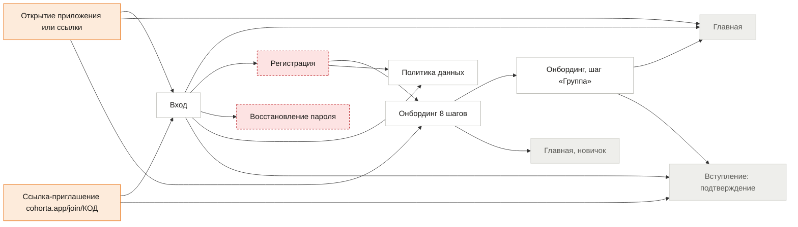
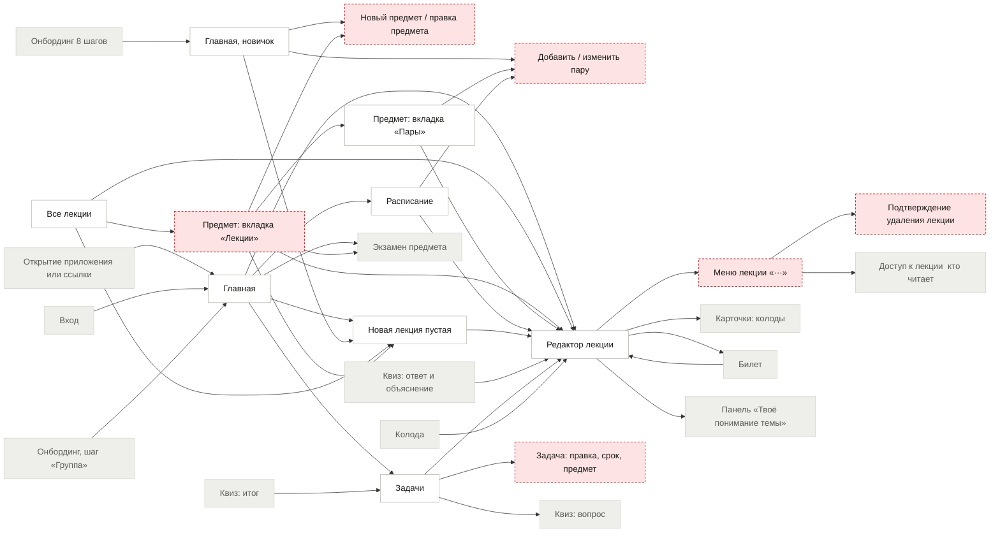
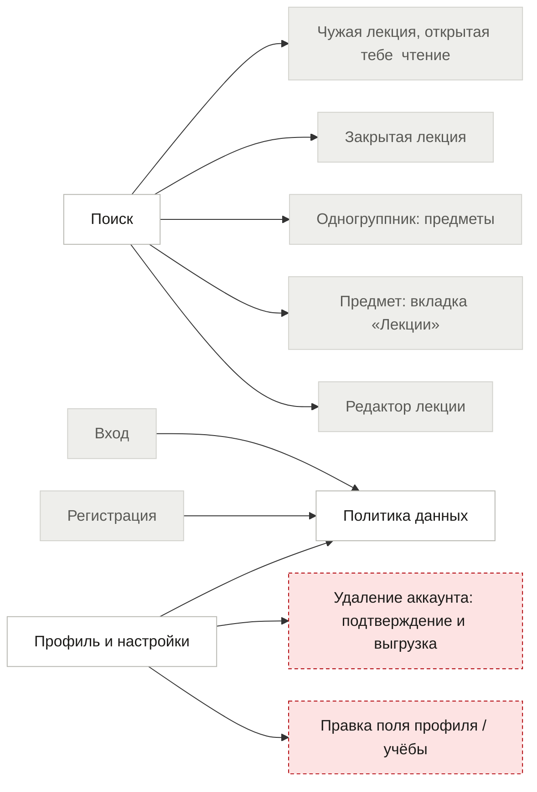
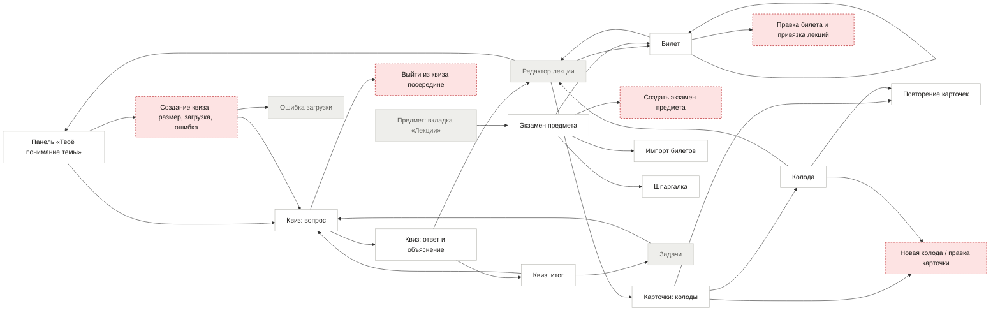
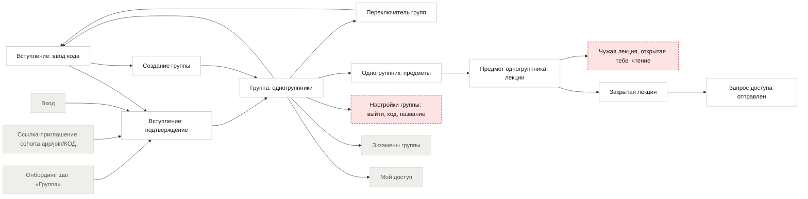
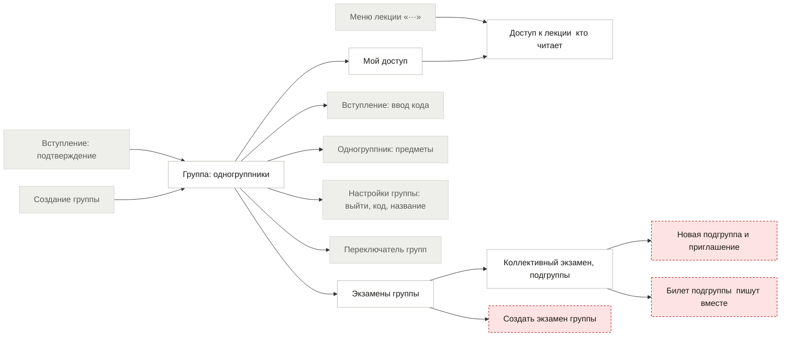

# Карта переходов cohorta (userflow)

Единственное место, где записано, из какого экрана можно попасть в какой и как. Для людей и для Claude Code.

## Как этим пользоваться (Claude Code)

1. Перед реализацией экрана найди его в таблицах ниже. Реализуй **все** входы и выходы из строки: каждая кнопка и ссылка из колонок «Откуда входят» и «Куда ведёт» должна работать.
2. Если у экрана нет входа или выхода, а нужен, или в таблице написано «не нарисован», **остановись и спроси**, не придумывай экран.
3. Колонку «Маршрут в коде» заполняй сам по реальному роутеру (пути вида `/s/:semesterSlug/...`). Расхождение между картой и роутером запиши в `PROGRESS.md`.
4. Новый экран или новый переход в коде: сначала строка в этой карте (и в `userflow.json`), потом код.
5. Название и поведение экранов служебных состояний (нет связи, ошибка, закрыта, сессия истекла) берутся из `States-system`.

Всего экранов и состояний: **64**, переходов: **139**, не нарисовано: **22**.

## Дыры, найденные при составлении карты

### Блокирует запуск

| # | Что не так | Экраны | Что нужно |
|---|---|---|---|
| 1.1 | **Регистрация и восстановление пароля не нарисованы.** Со входа есть ссылки «Создать аккаунт» и «Забыли пароль?», но за ними пусто. Нужно решить, подтверждается ли почта, и нарисовать: регистрация, письмо отправлено, новый пароль, пароль изменён. | `register, reset` | Решение Маргариты + макеты |
| 1.2 | **Чужая лекция, открытая тебе: экрана нет.** Это главный итог всей группы: одногруппник открыл лекцию, ты нажимаешь «Открыта тебе» и... куда? Нужно решить: только чтение или можно проходить квиз, делать карточки, копировать себе? Как выглядит шапка («Лекция Игоря Власова, только чтение»). | `g_read` | Решение Маргариты + макет |
| 1.3 | **Страница предмета, вкладка «Лекции».** Клик по предмету в меню слева и по ряду предметов на телефоне ведёт сюда. Есть вкладки «Пары» и «Экзамен», самой главной вкладки «Лекции» нет. Без неё путь «меню → предмет → лекция» не работает. | `subject` | Макет (десктоп и телефон) |
| 1.4 | **Создание квиза: размер, ожидание, ошибка ИИ.** После «Создать квиз» нет ни выбора размера, ни экрана ожидания, ни ошибки, если ИИ не ответил (превышен лимит, пустой конспект, нет связи). Это самое хрупкое место продукта. | `quiz_create` | Макет состояний |
| 1.5 | **Кто видит код приглашения: макет спорит с правилом безопасности.** В инструкции (шаг A0.5) код видит только владелец группы. В макете «Группа МК-31» код и «Сбросить код» показаны обычному участнику (Анастасия не создавала группу). Нужно выбрать: код видят все участники (проще, но любой может сбросить) или только владелец. Заодно решить, есть ли у группы владелец и что с ним, если он выйдет. | `g_home, g_settings` | Решение Маргариты |
| 1.6 | **Ссылка-приглашение у не вошедшего.** Человек открывает cohorta.app/join/КОД, у него нет аккаунта: код должен пережить регистрацию, онбординг и вход, и в конце показать подтверждение вступления, а не главную. Это главный способ привлечь первых людей. | `join_link, login, onb` | Решение + реализация |
| 1.7 | **Онбординг: в макетах 8 шагов, нарисовано 3, в IA написано 6.** Шаги 1, 5 и 7 нарисованы, шагов 2, 3, 4, 6 и 8 нет. Нужно договориться о списке шагов (предложение: имя, вуз и город, уровень, курс, семестры, начало недели, группа, предметы), нарисовать недостающие и поправить IA («6 шагов»). | `onb` | Решение + макеты |

### Нужно до запуска

| # | Что не так | Экраны | Что нужно |
|---|---|---|---|
| 2.1 | **Формы создания: предмет, пара, колода и карточка, экзамен, подгруппа, экзамен группы.** Везде есть кнопки «Добавить…», но формы не нарисованы. Часть можно собрать из готовых компонентов (окно с полями), но состав полей нужно определить. Подгруппа: как выбираются люди, что видит приглашённый, как не нарушить «один человек: одна подгруппа». | `subject_new, pair_edit, deck_edit, exam_new, g_exam_new, g_sub_new` | Макеты (можно одним листом «Формы») |
| 2.2 | **Новая лекция без предмета.** «Новая лекция» на главной: в какой предмет она попадает? Предложение: окно выбора предмета, последний использованный выбран заранее. Сейчас не определено. | `home, lecture_new` | Решение Маргариты |
| 2.3 | **Меню лекции «···» и удаление.** Туда ведёт «Доступ», но меню не нарисовано: переименовать, перенести в другой предмет, доступ, удалить. Удаление необратимо: нужно подтверждение, лучше с «Корзиной» на 30 дней. | `lecture_menu, lecture_delete` | Макет + решение про корзину |
| 2.4 | **Уведомления: как узнать про запрос и про открытый доступ.** Есть только счётчик у «Мой доступ». Если тебе открыли лекцию, об этом никто не сообщает. Предложение для MVP: счётчик на значке «Группа» и пометка «Новое» у открытой лекции; письма и пуши после запуска. | `g_myaccess` | Решение Маргариты |
| 2.5 | **Настройки группы: выйти, переименовать, сбросить код.** Выйти из группы нигде нельзя. Что происходит с чужими доступами к твоим лекциям и с твоим местом в подгруппе после выхода, не определено. | `g_settings` | Решение + макет |
| 2.6 | **Удаление аккаунта: подтверждение и выгрузка.** В настройках обещано «попросим подтвердить и предложим выгрузить данные», экрана нет. Нужен для заявленной политики данных. | `account_delete` | Макет |
| 2.7 | **Служебные: сессия истекла, лекции или группы нет, неверная ссылка.** Не определено, что видит человек, если лекцию удалили, его исключили или сессия закончилась на середине конспекта. Незаписанный текст не должен пропасть. | `expired, gone` | Макет + правило сохранения |
| 2.8 | **Билет подгруппы (совместная правка).** В тексте экрана «Билеты внутри подгруппы пишут вместе», но самого экрана билета подгруппы нет: кто сейчас пишет, что при одновременной правке, куда сохраняется ответ. | `g_ticket` | Макет + решение |
| 2.9 | **Выход из квиза посередине.** Закрыл вкладку или нажал назад на вопросе 5 из 8: прогресс сохраняется или нет? Предложение: сохраняется, при возвращении «Продолжить квиз». | `quiz_exit` | Решение |
| 2.10 | **Выбор лекции для билета.** «Привязать лекцию» ведёт в выбор, которого нет в макетах (поиск по лекциям предмета, несколько штук). | `ticket_edit` | Макет |

### Можно после запуска

| # | Что не так | Экраны | Что нужно |
|---|---|---|---|
| 3.1 | **Вкладка «Расписание повторов» у карточек.** Заголовок вкладки есть, содержимого нет. Можно оставить на после запуска, убрав вкладку. | `cards` | Решение |
| 3.2 | **Правка профиля и учёбы.** Рядом с каждым полем «Изменить». Окна простые, можно собрать из компонентов без отдельных макетов. | `settings_edit` | Реализация по компонентам |

### Уже исправлено при составлении карты

- В трёх текстах макетов было «Cohorta» с заглавной (онбординг, пустое состояние задач). Исправлено на «cohorta».
- Заголовок экрана «Курс одногруппника» заменён на «Предмет одногруппника» (по правилу «курс» только про год обучения).

## Схемы по разделам

Сплошная рамка: экран нарисован. Красная пунктирная: экрана нет. Серая: экран из другого раздела. Оранжевая: вход в приложение.

### Старт

Вход, регистрация, восстановление пароля, онбординг, ссылка-приглашение.

### Соло: учёба

Главная, лекции, предметы, расписание, задачи, редактор.

### Поиск и настройки

Поиск открывается с любого экрана, настройки через аватар.

### Соло: квиз, карточки, экзамен

Понимание темы, квиз, карточки, экзамен, билеты.

### Группа: вступление и люди

Вступить, создать, переключить группу, одногруппники и их лекции.

### Группа: доступ и экзамены

Мой доступ, доступ к лекции, экзамены группы и подгруппы.

## Экран за экраном

### Старт

| Экран | Макет | Откуда входят | Куда ведёт | Маршрут в коде | Заметки |
|---|---|---|---|---|---|
| **Открытие приложения или ссылки** (`open`) | нет (не экран) | вход в приложение | Вход: не вошёл Главная: вошёл, онбординг пройден Онбординг (8 шагов): вошёл, онбординг не пройден | |  |
| **Вход** (`login`) | Screen-login | Открытие приложения или ссылки: не вошёл Восстановление пароля: после нового пароля Политика данных: «Вход» / назад Ссылка-приглашение cohorta.app/join/КОД: не вошёл (код сохраняется) Профиль и настройки: выйти Удаление аккаунта: подтверждение и выгрузка: после удаления Сессия истекла: «Войти снова» | Главная: «Войти» Регистрация: «Создать аккаунт» Восстановление пароля: «Забыли пароль?» Политика данных: ссылка «политикой данных» Вступление: подтверждение: вошёл по ссылке: вернуться к подтверждению | | Есть «Забыли пароль?» и «Создать аккаунт» |
| **Регистрация** (`register`) | не нарисован | Вход: «Создать аккаунт» | Онбординг (8 шагов): после регистрации Политика данных: ссылка политики | | Не нарисована. Нужна почта, пароль, подтверждение почты или нет? |
| **Восстановление пароля** (`reset`) | не нарисован | Вход: «Забыли пароль?» | Вход: после нового пароля | | Не нарисовано: запрос письма, письмо, новый пароль |
| **Политика данных** (`policy`) | Screen-policy | Вход: ссылка «политикой данных» Регистрация: ссылка политики Профиль и настройки: «Читать» | Вход: «Вход» / назад | |  |
| **Онбординг (8 шагов)** (`onb`) | Screen-onboarding-1 | Открытие приложения или ссылки: вошёл, онбординг не пройден Регистрация: после регистрации | Онбординг, шаг «Группа»: шаг 7 Главная, новичок: после последнего шага | | Нарисованы шаги 1, 5 (Screen-onboarding-2) и 7. Шаги 2, 3, 4, 6 и 8 не нарисованы |
| **Онбординг, шаг «Группа»** (`onb_group`) | Screen-onboarding-3 | Онбординг (8 шагов): шаг 7 | Главная: «Далее» или пропустить Вступление: подтверждение: введён код → подтверждение | | Можно пропустить |
| **Ссылка-приглашение cohorta.app/join/КОД** (`join_link`) | нет (не экран) | вход в приложение | Вход: не вошёл (код сохраняется) Вступление: подтверждение: вошёл | | Не вошедшего ведёт на вход и потом возвращает к подтверждению |

### Соло: учёба

| Экран | Макет | Откуда входят | Куда ведёт | Маршрут в коде | Заметки |
|---|---|---|---|---|---|
| **Главная** (`home`) | Screen-dashboard; Screen-dashboard-mobile | Открытие приложения или ссылки: вошёл, онбординг пройден Вход: «Войти» Онбординг, шаг «Группа»: «Далее» или пропустить Настройки группы: выйти, код, название: «Выйти из группы» Нет связи: сеть вернулась Ошибка загрузки: «Повторить» Лекции или группы больше нет / нет прав: «На главную» | Поиск: строка поиска в шапке Профиль и настройки: аватар внизу меню Редактор лекции: «Продолжить», «Открыть лекцию», «Открыть конспект» Новая лекция (пустая): «Новая лекция», «Начать конспект» (без пары открывает чистую) Редактор лекции: «Начать конспект» на паре (создаёт лекцию на дату пары) Задачи: «Все задачи» Расписание: «Расписание» Квиз: вопрос: задача «Пройти квиз…», «Повторить» в блоке «Что повторить» Экзамен предмета: блок «Экзамен» (когда есть) | |  |
| **Главная, новичок** (`home_new`) | States-empty | Онбординг (8 шагов): после последнего шага | Новый предмет / правка предмета: «Добавить» предмет Добавить / изменить пару: «Добавить» пару Новая лекция (пустая): «Начать» | | Блок «С чего начать» |
| **Все лекции** (`lectures`) | Screen-lectures; Screen-m-lectures | Подтверждение удаления лекции: подтвердил | Редактор лекции: строка лекции Новая лекция (пустая): «Новая лекция» Предмет: вкладка «Лекции»: ряд предметов (телефон) / предмет в меню | |  |
| **Предмет: вкладка «Лекции»** (`subject`) | не нарисован | Все лекции: ряд предметов (телефон) / предмет в меню Новый предмет / правка предмета: «Сохранить» Предмет: вкладка «Пары»: вкладка «Лекции» Редактор лекции: ссылка назад к предмету Поиск: предмет | Редактор лекции: строка лекции Предмет: вкладка «Пары»: вкладка «Пары» Экзамен предмета: вкладка «Экзамен» Новый предмет / правка предмета: правка предмета Новая лекция (пустая): «Новая лекция» | | Не нарисована. Нужна как цель клика по предмету в меню и по ряду предметов на телефоне |
| **Новый предмет / правка предмета** (`subject_new`) | не нарисован | Главная, новичок: «Добавить» предмет Предмет: вкладка «Лекции»: правка предмета | Предмет: вкладка «Лекции»: «Сохранить» | | Не нарисовано: название, обложка (генератор), семестр |
| **Предмет: вкладка «Пары»** (`pairs`) | Screen-subject-pairs; Screen-m-subject-pairs | Предмет: вкладка «Лекции»: вкладка «Пары» Добавить / изменить пару: «Сохранить» | Добавить / изменить пару: «Добавить пару», строка пары Редактор лекции: «Конспект есть» Предмет: вкладка «Лекции»: вкладка «Лекции» | |  |
| **Добавить / изменить пару** (`pair_edit`) | не нарисован | Главная, новичок: «Добавить» пару Предмет: вкладка «Пары»: «Добавить пару», строка пары Расписание: «Добавить пару» | Предмет: вкладка «Пары»: «Сохранить» | | Не нарисовано: день, время, тип, аудитория, чётность |
| **Расписание** (`schedule`) | Screen-schedule; Screen-m-schedule | Главная: «Расписание» | Редактор лекции: пара с конспектом Редактор лекции: «Начать конспект» Добавить / изменить пару: «Добавить пару» | |  |
| **Новая лекция (пустая)** (`lecture_new`) | States-empty | Главная: «Новая лекция», «Начать конспект» (без пары открывает чистую) Главная, новичок: «Начать» Все лекции: «Новая лекция» Предмет: вкладка «Лекции»: «Новая лекция» | Редактор лекции: начал писать | | Новая лекция без названия. Куда попадает, если предмет не выбран, не решено |
| **Редактор лекции** (`editor`) | Screen-editor; Screen-m-editor | Главная: «Продолжить», «Открыть лекцию», «Открыть конспект» Главная: «Начать конспект» на паре (создаёт лекцию на дату пары) Все лекции: строка лекции Предмет: вкладка «Лекции»: строка лекции Предмет: вкладка «Пары»: «Конспект есть» Расписание: пара с конспектом Расписание: «Начать конспект» Новая лекция (пустая): начал писать Квиз: ответ и объяснение: «Показать в лекции, абзац…» Выйти из квиза посередине: выйти Квиз: итог: «К лекции», «Закрыть» Задачи: задача со ссылкой на лекцию Поиск: своя лекция Колода: «Лекция N» у карточки Билет: «Связанные лекции» | Меню лекции «···»: «···» Предмет: вкладка «Лекции»: ссылка назад к предмету Панель «Твоё понимание темы»: правая панель (на телефоне: кнопка «Понимание») Билет: плашка «Нужна для N билетов» Карточки: колоды: «+ Карточка» из меню «/» | | Содержание лекции: Screen-editor-toc и Screen-m-editor-toc. Меню «/»: Screen-editor-slash |
| **Меню лекции «···»** (`lecture_menu`) | не нарисован | Редактор лекции: «···» | Подтверждение удаления лекции: «Удалить» Доступ к лекции (кто читает): «Доступ» | | Не нарисовано: переименовать, перенести, доступ, удалить |
| **Подтверждение удаления лекции** (`lecture_delete`) | не нарисован | Меню лекции «···»: «Удалить» | Все лекции: подтвердил | | Не нарисовано |
| **Задачи** (`tasks`) | Screen-tasks; Screen-m-tasks | Главная: «Все задачи» Квиз: итог: автозадача «Повторить через день» Задача: правка, срок, предмет: «Сохранить» | Задача: правка, срок, предмет: строка задачи Редактор лекции: задача со ссылкой на лекцию Квиз: вопрос: задача «Квиз…» | |  |
| **Задача: правка, срок, предмет** (`task_edit`) | не нарисован | Задачи: строка задачи | Задачи: «Сохранить» | | Не нарисовано (быстрое добавление строкой есть) |
| **Поиск** (`search`) | Screen-search; Screen-m-search | Главная: строка поиска в шапке Группа: одногруппники: строка поиска в шапке | Редактор лекции: своя лекция Предмет: вкладка «Лекции»: предмет Одногруппник: предметы: одногруппник Закрытая лекция: чужая лекция (видно только название) Чужая лекция, открытая тебе (чтение): чужая лекция, открытая тебе | | Строка в шапке на каждом экране |
| **Профиль и настройки** (`settings`) | Screen-settings | Главная: аватар внизу меню Группа: одногруппники: «Профиль» Правка поля профиля / учёбы: «Сохранить» | Правка поля профиля / учёбы: «Изменить», «Сменить фото» Политика данных: «Читать» Удаление аккаунта: подтверждение и выгрузка: «Удалить аккаунт» Вход: выйти | | Аватар внизу меню, из любого экрана |
| **Правка поля профиля / учёбы** (`settings_edit`) | не нарисован | Профиль и настройки: «Изменить», «Сменить фото» | Профиль и настройки: «Сохранить» | | Не нарисовано: «Изменить», «Сменить фото» |
| **Удаление аккаунта: подтверждение и выгрузка** (`account_delete`) | не нарисован | Профиль и настройки: «Удалить аккаунт» | Вход: после удаления | | Не нарисовано. В настройках обещано «попросим подтвердить и предложим выгрузить» |

### Соло: повторение и экзамен

| Экран | Макет | Откуда входят | Куда ведёт | Маршрут в коде | Заметки |
|---|---|---|---|---|---|
| **Панель «Твоё понимание темы»** (`understanding`) | Screen-understanding; Screen-m-understanding | Редактор лекции: правая панель (на телефоне: кнопка «Понимание») | Создание квиза (размер, загрузка, ошибка): «Создать квиз», «Собрать другой» Квиз: вопрос: «Пройти квиз», «Проверить себя» | | Три состояния: нет квиза, квиз создан, квиз пройден |
| **Создание квиза (размер, загрузка, ошибка)** (`quiz_create`) | не нарисован | Панель «Твоё понимание темы»: «Создать квиз», «Собрать другой» | Квиз: вопрос: квиз готов Ошибка загрузки: ИИ не ответил | | Размер квиза, ожидание генерации и ошибка ИИ не нарисованы |
| **Квиз: вопрос** (`quiz_q`) | Screen-quiz-question; Screen-m-quiz | Главная: задача «Пройти квиз…», «Повторить» в блоке «Что повторить» Панель «Твоё понимание темы»: «Пройти квиз», «Проверить себя» Создание квиза (размер, загрузка, ошибка): квиз готов Квиз: ответ и объяснение: «Дальше» Квиз: итог: «Повторить слабые темы» Задачи: задача «Квиз…» | Квиз: ответ и объяснение: «Ответить», «Не помню» Выйти из квиза посередине: закрыть | |  |
| **Квиз: ответ и объяснение** (`quiz_a`) | Screen-quiz-answered | Квиз: вопрос: «Ответить», «Не помню» | Квиз: вопрос: «Дальше» Редактор лекции: «Показать в лекции, абзац…» Квиз: итог: последний вопрос | |  |
| **Квиз: итог** (`quiz_sum`) | Screen-quiz-summary | Квиз: ответ и объяснение: последний вопрос | Квиз: вопрос: «Повторить слабые темы» Редактор лекции: «К лекции», «Закрыть» Задачи: автозадача «Повторить через день» | |  |
| **Выйти из квиза посередине** (`quiz_exit`) | не нарисован | Квиз: вопрос: закрыть | Редактор лекции: выйти | | Не нарисовано: сохраняется ли прогресс |
| **Карточки: колоды** (`cards`) | Screen-cards; Screen-m-cards | Редактор лекции: «+ Карточка» из меню «/» Повторение карточек: «Закончить» | Колода: колода Повторение карточек: «Повторить N карточек» Новая колода / правка карточки: «Новая колода» | | Вкладка «Расписание повторов» не нарисована |
| **Колода** (`deck`) | Screen-deck; Screen-m-deck | Карточки: колоды: колода Новая колода / правка карточки: «Сохранить» | Повторение карточек: «Повторить N карточек» Новая колода / правка карточки: «Добавить карточку» Редактор лекции: «Лекция N» у карточки | |  |
| **Новая колода / правка карточки** (`deck_edit`) | не нарисован | Карточки: колоды: «Новая колода» Колода: «Добавить карточку» | Колода: «Сохранить» | | Не нарисовано |
| **Повторение карточек** (`cards_review`) | Screen-cards-review | Карточки: колоды: «Повторить N карточек» Колода: «Повторить N карточек» | Карточки: колоды: «Закончить» | |  |
| **Экзамен предмета** (`exam`) | Screen-exam; Screen-m-exam | Главная: блок «Экзамен» (когда есть) Предмет: вкладка «Лекции»: вкладка «Экзамен» Создать экзамен предмета: «Создать» Импорт билетов: «Добавить N билетов» Шпаргалка: назад | Билет: строка билета, «Открыть билет», «Продолжить» Импорт билетов: «Добавить билет», импорт Шпаргалка: вкладка «Шпаргалка» Создать экзамен предмета: нет экзамена у предмета | |  |
| **Создать экзамен предмета** (`exam_new`) | не нарисован | Экзамен предмета: нет экзамена у предмета | Экзамен предмета: «Создать» | | Не нарисовано: дата, выбор предмета. Пустое состояние «экзамена нет» тоже |
| **Билет** (`ticket`) | Screen-ticket | Редактор лекции: плашка «Нужна для N билетов» Экзамен предмета: строка билета, «Открыть билет», «Продолжить» Билет: «Следующий билет» Правка билета и привязка лекций: «Сохранить» | Правка билета и привязка лекций: «Изменить», «Привязать лекцию» Редактор лекции: «Связанные лекции» Билет: «Следующий билет» | |  |
| **Правка билета и привязка лекций** (`ticket_edit`) | не нарисован | Билет: «Изменить», «Привязать лекцию» | Билет: «Сохранить» | | Не нарисовано: «Изменить», «Привязать лекцию» (выбор лекции) |
| **Импорт билетов** (`ticket_import`) | Screen-ticket-import | Экзамен предмета: «Добавить билет», импорт | Экзамен предмета: «Добавить N билетов» | |  |
| **Шпаргалка** (`cheatsheet`) | Screen-cheatsheet | Экзамен предмета: вкладка «Шпаргалка» | Экзамен предмета: назад | |  |

### Группа

| Экран | Макет | Откуда входят | Куда ведёт | Маршрут в коде | Заметки |
|---|---|---|---|---|---|
| **Вступление: ввод кода** (`g_join`) | Screen-group-join | Группа: одногруппники: «Вступить в ещё одну» / режим «Группа» без группы Вступление: подтверждение: «Это не та группа» Переключатель групп: «Вступить в ещё одну» | Вступление: подтверждение: введён код Создание группы: «Создать свою группу» | |  |
| **Вступление: подтверждение** (`g_join_ok`) | Screen-group-join-confirm | Онбординг, шаг «Группа»: введён код → подтверждение Ссылка-приглашение cohorta.app/join/КОД: вошёл Вход: вошёл по ссылке: вернуться к подтверждению Вступление: ввод кода: введён код | Группа: одногруппники: «Вступить в МК-31» Вступление: ввод кода: «Это не та группа» | |  |
| **Создание группы** (`g_create`) | Screen-group-create | Вступление: ввод кода: «Создать свою группу» | Группа: одногруппники: «Создать группу» | |  |
| **Группа: одногруппники** (`g_home`) | Screen-group-home; Screen-m-group-people | Вступление: подтверждение: «Вступить в МК-31» Создание группы: «Создать группу» Переключатель групп: выбрать группу Настройки группы: выйти, код, название: «Сохранить» | Поиск: строка поиска в шапке Профиль и настройки: «Профиль» Вступление: ввод кода: «Вступить в ещё одну» / режим «Группа» без группы Переключатель групп: карточка группы в меню Одногруппник: предметы: «Открыть» у одногруппника Настройки группы: выйти, код, название: название группы, «Сбросить код» Мой доступ: «Мой доступ» Экзамены группы: «Экзамены группы» | |  |
| **Переключатель групп** (`g_switch`) | Screen-group-switcher; Screen-m-group-switcher | Группа: одногруппники: карточка группы в меню | Группа: одногруппники: выбрать группу Вступление: ввод кода: «Вступить в ещё одну» | |  |
| **Одногруппник: предметы** (`g_member`) | Screen-group-member | Поиск: одногруппник Группа: одногруппники: «Открыть» у одногруппника | Предмет одногруппника: лекции: предмет одногруппника | |  |
| **Предмет одногруппника: лекции** (`g_member_subj`) | Screen-group-thumbnails | Одногруппник: предметы: предмет одногруппника Запрос доступа отправлен: назад Чужая лекция, открытая тебе (чтение): назад | Чужая лекция, открытая тебе (чтение): «Открыта тебе» Закрытая лекция: строка закрытой лекции | | Файл назван «thumbnails», но это список. Заголовок в макете «Курс одногруппника» надо заменить на «Предмет» |
| **Чужая лекция, открытая тебе (чтение)** (`g_read`) | не нарисован | Поиск: чужая лекция, открытая тебе Предмет одногруппника: лекции: «Открыта тебе» | Предмет одногруппника: лекции: назад | | Не нарисовано. Только чтение? Можно ли пройти квиз? Решение нужно |
| **Закрытая лекция** (`g_closed`) | States-system | Поиск: чужая лекция (видно только название) Предмет одногруппника: лекции: строка закрытой лекции | Запрос доступа отправлен: «Запросить доступ» | | Кнопка «Запросить доступ» |
| **Запрос доступа отправлен** (`g_sent`) | States-system | Закрытая лекция: «Запросить доступ» | Предмет одногруппника: лекции: назад | |  |
| **Мой доступ** (`g_myaccess`) | Screen-group-access-my; Screen-m-group-access | Группа: одногруппники: «Мой доступ» Доступ к лекции (кто читает): «Готово» | Доступ к лекции (кто читает): «Открыть» у запроса, «Кому открыты лекции» Доступ к лекции (кто читает): «Убрать» у одного | |  |
| **Доступ к лекции (кто читает)** (`g_lecture_access`) | Screen-group-access | Меню лекции «···»: «Доступ» Мой доступ: «Открыть» у запроса, «Кому открыты лекции» Мой доступ: «Убрать» у одного | Мой доступ: «Готово» | |  |
| **Экзамены группы** (`g_exams`) | Screen-group-exams; Screen-m-group-exams | Группа: одногруппники: «Экзамены группы» | Коллективный экзамен, подгруппы: строка экзамена Создать экзамен группы: «Создать экзамен» | |  |
| **Коллективный экзамен, подгруппы** (`g_exam`) | Screen-group-exam | Экзамены группы: строка экзамена Создать экзамен группы: «Создать» Новая подгруппа и приглашение: «Готово» Билет подгруппы (пишут вместе): назад | Новая подгруппа и приглашение: «Новая подгруппа», «Пригласить в подгруппу» Билет подгруппы (пишут вместе): строка билета подгруппы | |  |
| **Создать экзамен группы** (`g_exam_new`) | не нарисован | Экзамены группы: «Создать экзамен» | Коллективный экзамен, подгруппы: «Создать» | | Не нарисовано |
| **Новая подгруппа и приглашение** (`g_sub_new`) | не нарисован | Коллективный экзамен, подгруппы: «Новая подгруппа», «Пригласить в подгруппу» | Коллективный экзамен, подгруппы: «Готово» | | Не нарисовано: выбор людей, подтверждение, «один человек: одна подгруппа» |
| **Билет подгруппы (пишут вместе)** (`g_ticket`) | не нарисован | Коллективный экзамен, подгруппы: строка билета подгруппы | Коллективный экзамен, подгруппы: назад | | Не нарисовано: у билета несколько авторов, видно, кто над ним работает |
| **Настройки группы: выйти, код, название** (`g_settings`) | не нарисован | Группа: одногруппники: название группы, «Сбросить код» | Группа: одногруппники: «Сохранить» Главная: «Выйти из группы» | | Не нарисовано. «Сбросить код» есть на экране группы, «Выйти из группы» нигде нет |

### Служебные

| Экран | Макет | Откуда входят | Куда ведёт | Маршрут в коде | Заметки |
|---|---|---|---|---|---|
| **Нет связи** (`offline`) | States-system | вход в приложение | Главная: сеть вернулась | |  |
| **Ошибка загрузки** (`error`) | States-system | Создание квиза (размер, загрузка, ошибка): ИИ не ответил | Главная: «Повторить» | |  |
| **Лекции или группы больше нет / нет прав** (`gone`) | не нарисован | вход в приложение | Главная: «На главную» | | Не нарисовано: удалена лекция, исключён из группы, неверная ссылка (404) |
| **Сессия истекла** (`expired`) | не нарисован | вход в приложение | Вход: «Войти снова» | | Не нарисовано: возврат на вход и возврат на прежний экран |
